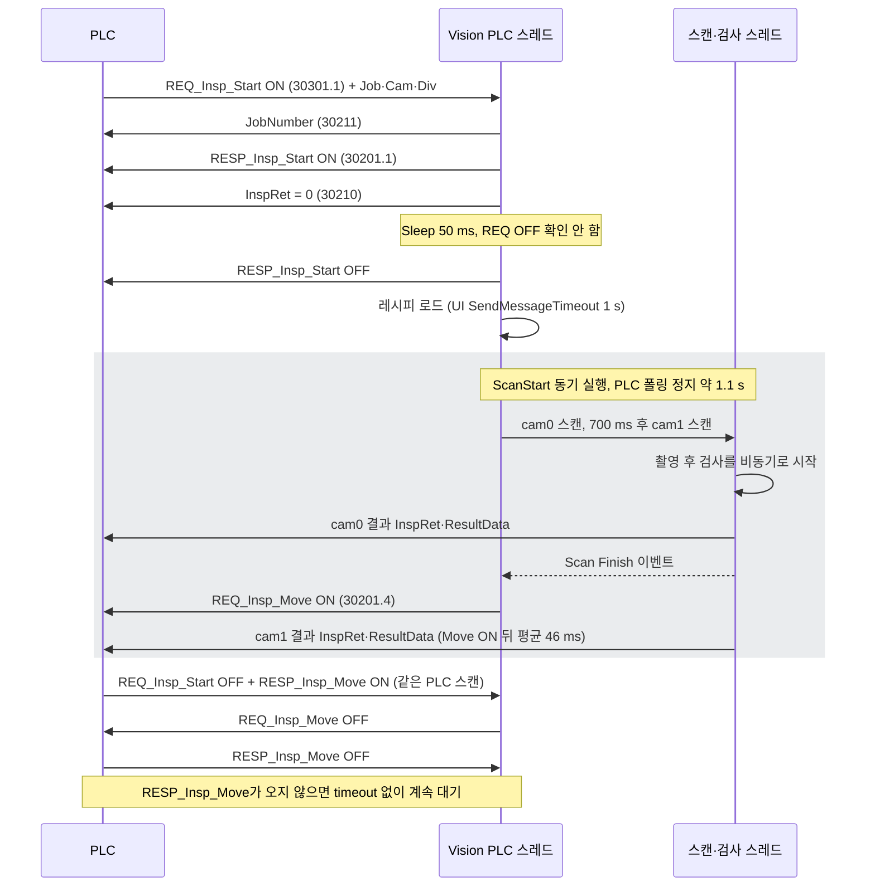

P15 · ANGT2301 HubisVIS Line · Borgwarner

# PLC 핸드쉐이크 시퀀스 분석

대상: Vision ↔ Mitsubishi PLC (MC 프로토콜 3E 바이너리, D 레지스터, 192.168.3.2:8106) · 근거: 소스 정적 분석과 현장 로그 Borgwarner_Log 2026-08-24 \~ 08-27 (53개 파일, 4,760 사이클) · 작성 2026-10-01 · 소스 변경 없음

### 결론

- 4,760 사이클 중 4,758 사이클은 정상 순서로 진행됐습니다. 통신 timeout, 읽기 실패, 재접속, 스캔 실패는 기간 중 **0건**입니다.
- 시퀀스 정지는 **2건**이고 둘 다 같은 패턴입니다. ① Vision이 `REQ_Insp_Move`를 냈는데 PLC의 `RESP_Insp_Move`가 관측되지 않았습니다. ② 다음 사이클의 Move 요청에서 PLC가 142초, 24.5초 동안 응답하지 않았습니다. ③ 이후 운전자가 프로그램을 재시작했습니다.
- Vision 쪽에는 이 상황을 정지로 굳히는 결함이 있습니다. 비트 하나를 쓸 때 **같은 워드의 다른 비트를 0으로 덮어씁니다**. 그래서 응답받지 못한 Move 요청이 다음 사이클의 Start 응답 쓰기 때 소리 없이 지워집니다. 또 Move 요청에 timeout·알람·복구가 없어 무한 대기합니다.
- PLC가 왜 첫 번째 Move에 응답하지 않았는지는 Vision 로그만으로 확정할 수 없습니다. PLC 래더 계약 확인이 필요합니다(아래 질문 목록).

**4,760**분석한 Start 사이클

**2**RESP_Insp_Move 미관측 → 정지 → 재시작

**4,756**결과(InspRet) 기록이 Move 요청보다 늦은 사이클

**0**통신 timeout · 재접속 · 스캔 실패

## 신호 맵

모든 신호는 D 레지스터의 워드 안 비트입니다. 같은 워드에 여러 신호가 함께 들어 있다는 점이 문제점 F1의 배경입니다.

| 주소 | 방향 | 신호 | Vision 처리 |
| --- | --- | --- | --- |
| D30300.0\~.6 | PLC→Vision | LinkTest, REQ_Initialize, REQ_TimeSync, REQ_ReadyInspection, ALARM, Auto, Manual | REQ_Initialize만 사용 |
| D30301.1 | PLC→Vision | REQ_Insp_Start | 상승 엣지에서 스캔 시작 |
| D30301.4 | PLC→Vision | RESP_Insp_Move | ON 동안 매 폴링마다 REQ_Move OFF 쓰기 |
| D30310\~30342 | PLC→Vision | InspMode, Model, Job, CameraIndex, DivIndex, ModelName, LotID, Scan_Pos_X/Y | 매 폴링 갱신 |
| D30200.0 | Vision→PLC | LinkTest | 500 ms마다 토글 (워드 전체 쓰기) |
| D30200.1 / .3 | Vision→PLC | RESP_Initialize / RESP_ReadyInspection | Ready는 시작 시 1회 ON, Initialize는 ON만 하고 OFF 하지 않음 |
| D30201.1 | Vision→PLC | RESP_Insp_Start | 50 ms 고정 펄스 |
| D30201.4 | Vision→PLC | REQ_Insp_Move | 스캔 완료 시 ON, RESP_Move 수신 시 OFF |
| D30210 / 30211 | Vision→PLC | InspRet (1 OK, 2 NG) / JobNumber | Start 시 0, 검사 스레드가 카메라별로 덮어씀 |
| D31000\~ | Vision→PLC | ResultData_000\~181 (double word) | 검사 스레드가 기록 |

## 현재 구현의 시퀀스

PLC 스레드 하나가 폴링, 응답 쓰기, 레시피 로드, 스캔 대기를 모두 순서대로 처리합니다. 스캔이 도는 약 1.1초 동안에는 PLC 입력을 읽지 않습니다.

## 정상 사이클 타이밍 (실측 중앙값)

4,760 사이클의 중앙값으로 그린 한 사이클입니다. 시간은 `REQ_Insp_Start ON`을 0으로 둔 ms입니다. 정상 사이클에서는 PLC의 `REQ_Start OFF`와 `RESP_Move ON`이 항상 같은 읽기에서 함께 관측됐습니다.

PLC → VisionVision → PLC빗금: Vision이 PLC를 읽지 않는 구간

- 1+141 ms: RESP_Insp_Start를 50 ms 뒤 무조건 내립니다. PLC는 REQ_Start를 1,175 ms 이상 지난 뒤, Move 요청을 본 다음에야 내립니다. 그래서 RESP_Start가 PLC 쪽에서 실제 응답 신호로 쓰이는지 불분명합니다.
- 2+1,257 ms: REQ_Insp_Move ON. 이 시점에 cam1 결과는 아직 기록되지 않았습니다. 평균 46 ms, 최대 168 ms 뒤에 기록됩니다.
- 3+1,376 ms: PLC가 REQ_Start OFF와 RESP_Move ON을 같은 스캔에서 냅니다. Vision이 처음 읽을 수 있는 시점은 Move ON 뒤 88\~96 ms이고, 관측된 최소 응답 93 ms와 겹칩니다.

## 정지 사건 1 · 2026-08-25 09:40 (Seq 1579 → 1580)

기준 시각 0 = 09:40:42.693 (Seq 1579 REQ_Insp_Move ON). 결과 OK, 직전 사이클까지 모두 정상.

- 1+126 ms: PLC가 REQ_Start를 내렸지만 RESP_Insp_Move는 이후 441 ms 동안 한 번도 관측되지 않았습니다. 정상 4,758회에서는 둘이 항상 함께 보였습니다.
- 2+487 ms: 다음 사이클의 `RESP_Insp_Start ON` 쓰기가 D30201 전체를 `0x0002`로 씁니다. 같은 워드의 REQ_Insp_Move(bit 4)가 응답 없이 0이 됩니다. Vision 로그에는 이 OFF가 기록되지 않습니다.
- 3+1,665 ms: REQ_Insp_Move ON을 다시 냈지만 PLC는 142초 동안 응답하지 않았습니다. Vision은 timeout·알람 없이 대기했습니다. 09:43:06에 RESP_Move가 들어왔고(Job 1, Div 0, PLC 측 원점 복귀로 추정), 09:43:24 프로그램 종료, 09:43:47 재시작.

## 정지 사건 2 · 2026-08-26 10:49 (Seq 1709 → 1710)

기준 시각 0 = 10:49:21.734 (Seq 1709 REQ_Insp_Move ON). 사건 1과 같은 순서로 진행됐습니다.

- 1+148 ms: REQ_Start OFF, RESP_Move 미관측.
- 2+492 ms: RESP_Insp_Start ON 쓰기가 REQ_Insp_Move 비트를 지웁니다.
- 3+1,685 ms: REQ_Insp_Move ON. PLC는 REQ_Start를 5.9초 더 유지했고(정상 118 ms) RESP_Move는 24.5초 뒤에 왔습니다. 10:50:06 프로그램 종료.

두 사건 모두 OK·NG 판정과는 상관이 없습니다. NG 2,544 사이클 중 Move 지연은 이 1건뿐이고, OK 2,211 사이클 중에서도 사건 1의 1건뿐입니다. 공통점은 **Move 응답을 받지 못한 사이클 바로 다음**이라는 것입니다.

## 문제점

HIGH

### F1. 비트 쓰기가 같은 워드의 다른 비트를 0으로 덮어씀

사건에서 발생

근거

`CtrlPLC.cpp:233-248` `WriteData()`는 `buffer=0`에서 대상 비트만 세운 뒤 워드 1개를 통째로 씁니다. 장치는 D 레지스터 워드 쓰기(`CtrlPLC_Melsec.cpp:1182`)입니다.

영향

D30201: RESP_Start ON을 쓰면 REQ_Move가 꺼지고, REQ_Move를 쓰면 RESP_Start가 꺼집니다. 응답받지 못한 Move 요청이 다음 Start 응답 때 사라집니다(사건 ②).\
D30200: 500 ms마다 LinkTest를 쓰면(`DlgVisionMain.cpp:370-378`, `PLCSocketManager.cpp:150-161`) 시작 시 1회만 켠 **RESP_ReadyInspection**(`DlgMain2.cpp:276-280`)과 RESP_Initialize, ALARM, Auto, Manual이 꺼집니다. 운전 중 Ready는 사실상 OFF입니다.

HIGH

### F2. Move 요청에 timeout·알람·복구가 없음

사건에서 발생

근거

`PLCSocketManager.cpp:339-356`는 RESP_Move를 받았을 때만 REQ_Move를 내립니다. 응답 대기 시간 감시가 없습니다.

영향

PLC 응답이 없으면 Vision은 경고 로그 하나 없이 대기하고, 운전자는 재시작 외에 할 수 있는 일이 없습니다. 실측 정상 응답은 최대 177 ms인데 정지 시 142 s, 24.5 s였습니다.

HIGH

### F3. 검사 결과보다 Move 요청이 먼저 나감

상시 발생

근거

스캔 스레드는 검사를 비동기로 시작하고 바로 Finish를 알립니다(`ScanManager.cpp:495, 286`). 그러면 PLC 스레드가 REQ_Move ON을 씁니다(`PLCSocketManager.cpp:594-603`). 결과는 검사 스레드가 UI 갱신을 마친 뒤 씁니다(`InspectionManager.cpp:309-346`).

영향

4,760 사이클 중 4,756 사이클에서 마지막 InspRet 기록이 Move ON보다 늦었고(평균 +46 ms, 최대 +168 ms), 28 사이클은 PLC가 Move에 응답한 뒤에야 기록됐습니다. PLC가 Move 시점에 결과를 읽으면 0이나 한 카메라 값만 읽습니다. 또 검사 결과가 비면 PLC에 아무것도 쓰지 않습니다(`PLCManager.cpp:300-303`, 189 사이클). 이때 해당 카메라의 ResultData는 이전 제품 값이 남습니다.

MEDIUM

### F4. RESP_Insp_Start가 50 ms 고정 펄스

근거

`PLCSocketManager.cpp:264, 285-288`: ON, 50 ms Sleep, OFF. REQ_Start가 내려갔는지 확인하지 않습니다.

영향

PLC 스캔 주기와 MC 프로토콜 처리 시점에 따라 PLC가 이 펄스를 놓칠 수 있습니다. 실측상 PLC는 RESP_Start가 아니라 REQ_Move를 보고 REQ_Start를 내리므로 현재 래더가 이 신호를 쓰는지부터 확인해야 합니다.

MEDIUM

### F5. 스캔 중 PLC 폴링 정지

근거

`ScanStart()`가 PLC 스레드 안에서 동기로 실행됩니다(`PLCSocketManager.cpp:327`). 카메라 간 700 ms Sleep, 완료 대기 최대 5 s, 실패 시 복구 대기 1 s/카메라가 포함됩니다.

영향

정상에서도 약 1.1 s, 실패 시 최대 약 8 s 동안 입력을 읽지 않고 LinkTest도 멈춥니다. PLC가 RESP_Move를 짧게 펄스로 내면 Move ON 뒤 88\~96 ms의 공백에 묻힐 수 있습니다. 또 스캔 직후 확인하는 `m_bScanDone`은 스캔 전에 읽은 값이라, PLC가 이전 RESP_Move를 아직 유지하고 있었다면 방금 켠 REQ_Move를 바로 끕니다(`:339`, 이 기간 로그에서는 미발생).

MEDIUM

### F6. 통신 오류 후 재접속이 실제로 새 연결을 만들지 않음

근거

timeout이나 recv 오류가 나도 `m_bConnected`를 리셋하지 않습니다. 읽기 실패 시 스레드는 Disconnect 없이 루프를 빠지고(`PLCSocketManager.cpp:163-176`), 재접속 시 `PLC_Connect()`는 기존 소켓으로 바로 TRUE를 반환합니다(`CtrlPLC_Melsec.cpp:135-136`). 응답은 recv 한 번으로 받고 길이를 검증하지 않습니다(`:955-1001`). timeout 뒤 늦게 온 응답도 버리지 않습니다.

영향

네트워크가 한 번 흔들리면 요청과 응답이 한 칸씩 어긋나거나 죽은 소켓에 계속 매달릴 수 있습니다. 이 기간에는 timeout이 0건이라 발생하지 않았지만, 발생하면 재시작 전까지 회복되지 않는 형태입니다.

LOW

### F7. 스캔 실패 통보가 PLC에 도달하지 않음

근거

실패 경로(`PLCSocketManager.cpp:575-578`)는 RESP_Start ON 직후 REQ_Move OFF를 씁니다. F1 때문에 RESP_Start가 바로 0이 됩니다.

영향

PLC는 실패 신호도 Move 요청도 받지 못해 정지합니다. 이 기간 스캔 실패는 0건입니다.

LOW

### F8. 초기화 요청 중 폴링 루프가 크게 느려짐

근거

REQ_Initialize가 ON인 동안 매 루프마다 ResultData 182개를 하나씩 쓰고 RESP_Initialize ON을 다시 씁니다(`PLCSocketManager.cpp:358-390`). RESP_Initialize OFF 코드는 주석 처리되어 있습니다.

영향

쓰기 1회 약 16 ms 기준 루프 1회가 약 3 s로 늘어납니다. 그동안 Start 엣지 감지가 늦어집니다. 응답 해제는 LinkTest의 덮어쓰기(F1)에 우연히 의존합니다.

## PLC 측 확인이 필요한 항목

정지의 첫 단계(PLC가 Move에 응답하지 않은 이유)는 래더를 봐야 확정할 수 있습니다.

1. RESP_Insp_Move의 ON·OFF 조건: REQ_Move가 OFF될 때까지 유지하는지, 타이머나 단일 스캔 펄스인지.
2. REQ_Move가 응답 전에 꺼졌다가 다시 켜질 때 PLC 시퀀스가 어떤 상태로 가는지(사건 ②→③).
3. PLC가 InspRet·ResultData를 읽는 시점: REQ_Move ON 순간인지, 그 뒤인지. 값이 0일 때의 동작.
4. RESP_Insp_Start와 RESP_ReadyInspection을 인터록에 쓰는지. 쓴다면 F1 때문에 Ready가 꺼져 있는 상태를 PLC가 어떻게 처리하는지.
5. LinkTest 감시 시간(watchdog). Vision은 스캔 중 최대 수 초 동안 토글하지 않습니다.
6. PLC 스캔 주기와 MC 프로토콜 응답 처리 시점(END 처리).
7. 08-25 09:40\~09:43, 08-26 10:49\~10:50의 PLC 알람·이력.

## 개선 방향 (승인 전, 미적용)

아래는 제안이며 기존 구현은 바꾸지 않았습니다. 위험이 낮은 진단부터 단계적으로 진행하기를 권합니다.

| 순서 | 내용 | 대상 | 관련 |
| --- | --- | --- | --- |
| 1 | 진단 로그만 추가: Move 요청 후 RESP 미수신 경고(예: 500 ms), 다음 Start가 왔는데 Move가 미완료인 경우, 워드 쓰기 전후 값 기록 | PLCSocketManager.cpp | F1 F2 |
| 2 | 출력 워드 shadow 유지: 30200·30201 워드를 캐시에서 다른 비트를 보존한 채 쓰기 | CtrlPLC.cpp WriteData | F1 F7 |
| 3 | Move 요청 timeout과 알람, 재시도 정책(PLC 계약 확정 후) | PLCSocketManager.cpp | F2 |
| 4 | 완료 장벽: 두 카메라 결과 기록 성공 뒤에만 REQ_Move ON, 빈 결과도 명시적으로 기록 | ScanManager / InspectionManager / PLCManager | F3 |
| 5 | Start 4-phase: REQ ON → RESP ON 유지 → REQ OFF 확인 → RESP OFF (래더 계약 확인 후) | PLCSocketManager.cpp | F4 |
| 6 | 오류 시 소켓 정리 후 재접속, 응답 헤더 길이 기반 수신, 늦은 응답 폐기 | CtrlPLC_Melsec.cpp | F6 |

2번(shadow 쓰기)을 적용하면 Ready·Initialize 비트가 실제로 유지되기 시작합니다. 그러면 지금과 다른 PLC 동작이 나올 수 있으므로 래더 확인과 오프라인 시험을 먼저 해야 합니다. 실장비·PLC 시험은 별도 승인 후 진행합니다.

분석 방법: `PLCSocketManager`, `CtrlPLC`, `CtrlPLC_Melsec`, `PLCManager`, `ScanManager`, `InspectionManager`, `DlgVisionMain`, `DlgMain2`와 `PLCMap.ini`를 읽어 신호 흐름을 추적했습니다. 현장 로그의 `[PLC_START_DIAG]`, `[PLC_MOVE_DIAG]`, 결과 기록 로그를 사이클 단위로 묶어 통계를 냈습니다. 로그 시각은 쓰기 완료 후 기록되므로 실제 전송 시각과 수 ms\~수십 ms 차이가 있습니다. 빌드·실행·PLC 시험은 하지 않았습니다.