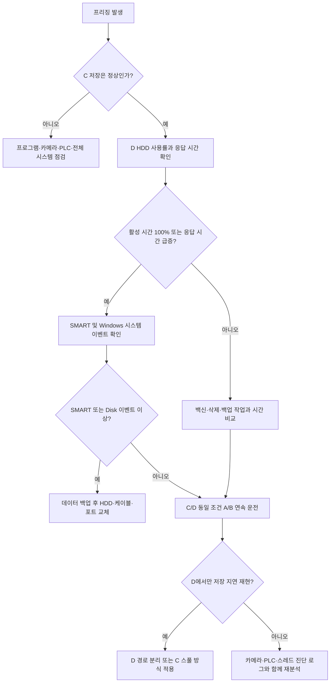
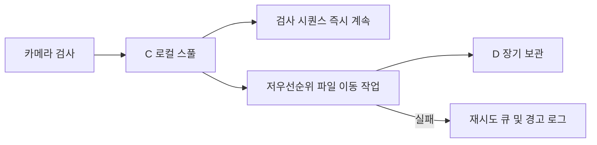

# HDD 저장 경로 프리징 진단 및 조치 매뉴얼

> [!summary] 목적
> 장비 PC의 C 드라이브와 D 드라이브가 **서로 다른 HDD**이고, C 드라이브 저장 시에는 정상이나 D 드라이브 저장 시 간헐적으로 프로그램이 멈추는 현상을 진단하고 조치하기 위한 현장 매뉴얼이다.

> [!important] 현재 판단
> C에서는 정상이고 D에서만 프리징된다면 D HDD, SATA 연결, 전원, 파일 시스템 또는 D에서 수행되는 백신·삭제 작업을 우선 의심한다. 단순히 “두 드라이브 모두 HDD”라는 이유만으로 동일한 성능이라고 판단하면 안 된다.

![[assets/hdd-save-path-freezing-overview.png]]

그림에서 위쪽 HDD는 정상적으로 저장되는 경로이고, 아래쪽 HDD는 쓰기 지연 때문에 이미지 작업이 누적되는 경로를 나타낸다. D 드라이브가 순간적으로 수 초 이상 응답하지 않으면 이미지 저장 큐가 쌓이고, 과거 버전에서는 큐 공간을 계속 기다리면서 검사 시퀀스가 프리징처럼 보일 수 있었다.

## 1. 적용 대상과 증상

다음 조건 중 하나 이상이면 이 매뉴얼을 적용한다.

- [ ] C 드라이브 저장 시에는 정상 운전된다.
- [ ] D 드라이브 저장 시에만 간헐적으로 화면 또는 시퀀스가 멈춘다.
- [ ] 멈춤 시 D 디스크 활성 시간이 100%에 근접한다.
- [ ] 멈춤 시 D 쓰기 속도는 낮지만 응답 시간은 매우 높다.
- [ ] 재부팅하면 일시적으로 정상화된다.
- [ ] 일정 수량 생산 후 또는 대량 이미지 저장 후 발생한다.
- [ ] 오래된 데이터 삭제 시간과 프리징 시간이 겹친다.

## 2. 예상 원인 우선순위

| 우선순위 | 예상 원인 | 대표 증상 |
|---:|---|---|
| 1 | D HDD 불량 또는 SMART 이상 | 배드섹터, 재할당 섹터, 대기 섹터 증가 |
| 2 | SATA 데이터/전원 케이블 또는 포트 불량 | 이벤트 ID 129, 153, 연결 재시도 |
| 3 | D HDD의 순간 쓰기 지연 | 활성 시간 100%, 응답 시간 수천 ms, 처리량 급락 |
| 4 | SMR HDD의 캐시 소진 | 처음에는 정상이나 연속 저장 후 급격히 느려짐 |
| 5 | 백신·인덱싱·백업 프로그램 경합 | 이미지 생성 직후 디스크 사용률 상승 |
| 6 | 여유 공간 부족 또는 단편화 | 폴더 생성과 작은 파일 저장이 점점 느려짐 |
| 7 | 이미지 저장과 파일 삭제의 동시 수행 | 특정 시간대 또는 보관 기간 경과 시 발생 |
| 8 | 디스크 절전 복귀 지연 | 장시간 대기 후 첫 검사에서 수 초 정지 |

## 3. 전체 점검 흐름



## 4. 현장 안전 수칙

> [!danger] 반드시 준수
> SATA 케이블, 전원 케이블 또는 HDD를 교체할 때는 장비 프로그램을 종료하고 Windows를 정상 종료한 다음 장비 PC의 전원을 완전히 차단한다. 전원이 인가된 상태에서 SATA 전원 케이블을 분리하지 않는다.

- 생산 중 점검이 필요한 경우 설비 담당자에게 먼저 정지 승인을 받는다.
- D 드라이브에 필요한 생산 데이터가 있으면 점검 전에 백업한다.
- `chkdsk /f`, 포맷, 초기화, 파티션 변경은 사전 승인 없이 실행하지 않는다.
- SMART 상태가 주의 또는 위험이면 쓰기 테스트보다 데이터 백업을 먼저 수행한다.

## 5. 1단계 — 프리징 순간의 디스크 상태 확인

### 5.1 작업 관리자 열기

1. `Ctrl + Shift + Esc`를 누른다.
2. **성능** 탭을 선택한다.
3. C 디스크와 D 디스크를 각각 선택한다.
4. 프로그램 프리징이 발생할 때 아래 항목을 기록한다.

| 확인 항목 | 정상 참고값 | 이상 판단 예시 |
|---|---:|---:|
| 활성 시간 | 저장 중 일시 상승 가능 | 100%가 수 초 이상 지속 |
| 평균 응답 시간 | 일반적으로 수십 ms 이하 | 수백~수천 ms 이상 |
| 쓰기 속도 | 저장 시 지속적으로 발생 | 0~수 MB/s인데 활성 시간은 100% |
| 디스크 큐 | 짧게 증가 후 감소 | 계속 증가하고 감소하지 않음 |

> [!tip] 판정 핵심
> HDD는 쓰기 속도만 보면 안 된다. **쓰기 속도가 낮은데 활성 시간 100%, 응답 시간 수천 ms**라면 디스크가 요청을 처리하지 못하고 대기 중일 가능성이 높다.

### 5.2 장애 기록 남기기

프리징이 발생하면 다음 정보를 기록한다.

- 발생 시각: `YYYY-MM-DD HH:mm:ss`
- 검사 제품 또는 바코드:
- 저장 경로: C 또는 D
- C 디스크 활성 시간/응답 시간:
- D 디스크 활성 시간/응답 시간:
- 프로그램이 자동 복구됐는지:
- 복구까지 걸린 시간:
- 같은 시각의 로그 파일명:

## 6. 2단계 — HDD 모델과 상태 확인

![[assets/hdd-diagnostic-checklist.png]]

### 6.1 PowerShell 기본 확인

관리자 PowerShell에서 실행한다.

```powershell
Get-PhysicalDisk |
    Select-Object FriendlyName, MediaType, BusType, HealthStatus, OperationalStatus, Size
```

정상 기준:

- `HealthStatus`: `Healthy`
- `OperationalStatus`: `OK`
- C와 D가 서로 다른 모델 또는 서로 다른 물리 디스크로 표시되는지 확인

> [!note]
> `Healthy`만으로 HDD가 완전히 정상이라고 단정할 수 없다. 상세 SMART 정보와 Windows 이벤트를 함께 확인해야 한다.

### 6.2 SMART 확인

CrystalDiskInfo 또는 제조사 진단 도구를 사용해 C와 D를 각각 확인한다.

특히 다음 항목을 기록한다.

| SMART 항목 | 의미 | 조치 기준 |
|---|---|---|
| Reallocated Sector Count | 재할당된 불량 섹터 | 0보다 크고 증가하면 교체 검토 |
| Current Pending Sector Count | 읽기 불안정 대기 섹터 | 1 이상이면 즉시 백업·교체 우선 |
| Uncorrectable Sector Count | 복구 불가능 섹터 | 1 이상이면 HDD 교체 권장 |
| UltraDMA CRC Error Count | SATA 통신 오류 | 증가하면 케이블·포트 우선 교체 |
| Power-On Hours | 누적 사용 시간 | 장시간 사용 HDD는 예방 교체 검토 |
| Temperature | HDD 온도 | 지속적으로 50°C 이상이면 냉각 점검 |

판정:

- **정상:** 모든 위험 항목 0, 상태 좋음, CRC 증가 없음
- **주의:** 재할당/대기 섹터 존재, CRC 오류 증가, 온도 과다
- **위험:** 보정 불가능 섹터, SMART 경고, 반복적인 인식 끊김

## 7. 3단계 — Windows 시스템 이벤트 확인

1. `Win + R`을 누른다.
2. `eventvwr.msc`를 입력한다.
3. **Windows 로그 → 시스템**으로 이동한다.
4. 우측의 **현재 로그 필터링**을 선택한다.
5. 프리징 발생 전후 10분 범위를 확인한다.

확인할 이벤트 원본과 ID:

| 원본 | 주요 ID | 의미 |
|---|---:|---|
| Disk | 7 | 불량 블록 가능성 |
| Disk | 51 | 디스크 I/O 오류 |
| Disk | 153 | I/O 재시도 또는 지연 |
| storahci | 129 | SATA 컨트롤러 리셋·타임아웃 |
| Ntfs | 55 | NTFS 파일 시스템 손상 가능성 |
| iaStorA | 129 등 | Intel 저장장치 컨트롤러 타임아웃 |

> [!warning]
> 이벤트 ID 129 또는 153이 반복되면 HDD 자체뿐 아니라 SATA 케이블, 전원 케이블, 메인보드 SATA 포트도 반드시 점검한다.

## 8. 4단계 — 케이블과 SATA 포트 점검

다음 순서로 한 번에 하나씩 변경하고 결과를 기록한다.

1. 장비 프로그램을 종료한다.
2. Windows를 정상 종료한다.
3. PC 전원을 완전히 차단하고 전원 플러그를 분리한다.
4. D HDD의 SATA 데이터 케이블을 새 케이블로 교체한다.
5. D HDD의 SATA 전원 커넥터를 다른 전원 라인으로 변경한다.
6. 메인보드의 다른 SATA 포트로 변경한다.
7. 전원을 켜고 BIOS와 Windows에서 D가 정상 인식되는지 확인한다.
8. 동일 조건으로 연속 운전한다.

| 변경 항목 | 변경 전 | 변경 후 | 프리징 재발 | 판정 |
|---|---|---|---|---|
| SATA 데이터 케이블 |  |  | 예 / 아니오 |  |
| SATA 전원 라인 |  |  | 예 / 아니오 |  |
| 메인보드 SATA 포트 |  |  | 예 / 아니오 |  |

CRC 오류가 더 이상 증가하지 않고 프리징이 사라지면 케이블 또는 포트 문제로 판단한다.

## 9. 5단계 — D 드라이브 운영 환경 점검

### 9.1 여유 공간

- D 드라이브 여유 공간을 최소 20~25% 확보한다.
- 휴지통과 불필요한 임시 파일을 확인한다.
- 생산 데이터 삭제는 프로그램 운전 중이 아닌 정비 시간에 수행한다.

### 9.2 백신·인덱싱·백업 경합

설비 보안 정책 담당자의 승인을 받아 다음을 확인한다.

- `D:\Hubis Data`가 백신 실시간 검사 대상인지
- Windows Search 인덱싱 대상인지
- 백업 또는 동기화 프로그램이 같은 폴더를 감시하는지
- 이미지가 생성될 때마다 별도 분석 프로그램이 파일을 여는지

> [!caution]
> 보안 프로그램 제외 설정은 현장 보안 정책 승인을 받은 후 적용한다. 임의로 백신 전체를 끄지 않는다.

### 9.3 디스크 절전

1. 제어판에서 **전원 옵션**을 연다.
2. 사용 중인 전원 관리 옵션의 **고급 전원 관리 옵션 설정 변경**을 선택한다.
3. **하드 디스크 → 다음 시간 이후에 하드 디스크 끄기**를 확인한다.
4. 장비 정책에 따라 `0분(사용 안 함)` 적용을 검토한다.

장시간 대기 후 첫 검사에서만 지연된다면 절전 복귀가 원인일 가능성이 있다.

## 10. 6단계 — C/D A/B 비교 시험

### 10.1 시험 조건

C와 D 시험 조건을 반드시 동일하게 맞춘다.

- 동일 제품과 동일 레시피
- 동일 카메라 및 조명
- 동일한 RAW/결과 이미지/CSV 저장 옵션
- 각 드라이브에 새 빈 시험 폴더 사용
- 가능하면 각각 최소 1~2시간 또는 동일 수량 운전
- 시험 중 다른 파일 복사나 백업 금지

권장 시험 경로:

```text
C:\Hubis_Test\Raw
C:\Hubis_Test\Result
D:\Hubis_Test\Raw
D:\Hubis_Test\Result
```

### 10.2 기록표

| 항목 | C 시험 | D 시험 |
|---|---:|---:|
| 시험 시작/종료 시각 |  |  |
| 생산 수량 |  |  |
| 프리징 횟수 |  |  |
| 최대 디스크 응답 시간 |  |  |
| `[STORAGE_IO]` 발생 횟수 |  |  |
| `[STORAGE_BACKPRESSURE]` 발생 횟수 |  |  |
| RAW 저장 누락 횟수 |  |  |
| Disk/129/153 이벤트 |  |  |

### 10.3 판정

- C 정상, D 재현: D HDD 또는 D 연결·운영 환경 문제로 판단
- C와 D 모두 재현: 저장장치 외 카메라, PLC, 프로그램 스레드 포함 재분석
- 케이블 교체 후 D 정상: 케이블 또는 포트 문제로 판단
- 새 HDD 교체 후 정상: 기존 D HDD 문제로 판단
- 백신 제외 후 정상: 실시간 검사 경합으로 판단

## 11. 프로그램 로그 확인 방법

로그 위치:

```text
D:\02.Works\04.Codex\P15.ANGT2301_HubisVIS_Line\bin\Log
```

중점 검색 키:

| 로그 키 | 의미 | 조치 |
|---|---|---|
| `[STORAGE_IO][WARN]` | 단일 이미지 저장 시간이 비정상적으로 김 | 해당 시각의 D 응답 시간 확인 |
| `[STORAGE_BACKPRESSURE]` | RAW 저장 큐가 상한에 도달 | D 처리량·지연·백신 경합 확인 |
| `RAW save dropped` | 3초 내 큐가 회복되지 않아 RAW 저장 생략 | 저장장치 즉시 점검, 누락 수량 기록 |
| `[SCAN_DIAG]` | 스캔 완료 대기 실패 또는 복구 수행 | 저장 지연과 같은 시각인지 비교 |
| `[THREAD_DIAG]` | 종료 시 스레드가 5초 안에 끝나지 않음 | 소켓·카메라·저장 I/O 상태 확인 |
| `[CAMERA_DIAG]` | 카메라 grab이 2초 내 종료되지 않음 | 저장 문제와 분리해 카메라 점검 |
| `[PLC_LINK_DIAG]` | PLC LinkTest 쓰기가 지연됨 | PLC 네트워크 또는 PLC 응답 확인 |

PowerShell 검색 예시:

```powershell
Get-ChildItem "D:\02.Works\04.Codex\P15.ANGT2301_HubisVIS_Line\bin\Log" -Recurse -File |
    Select-String -Pattern "STORAGE_IO|STORAGE_BACKPRESSURE|SCAN_DIAG|THREAD_DIAG|CAMERA_DIAG|PLC_LINK_DIAG"
```

> [!important] 변경된 프로그램 동작
> RAW 저장 큐가 포화되면 최대 3초까지만 기다린다. 이후 검사 시퀀스 진행을 우선하고 해당 RAW 이미지는 저장하지 않으며 `[STORAGE_BACKPRESSURE][ERROR] RAW save dropped` 로그를 남긴다. 따라서 프리징이 줄어든 대신 HDD 문제가 계속되면 RAW 이미지 누락이 발생할 수 있다.

## 12. 조치 결정표

| 확인 결과 | 즉시 조치 | 최종 조치 |
|---|---|---|
| SMART 위험 또는 Pending Sector 존재 | 생산 데이터 백업 | D HDD 교체 |
| CRC Error가 계속 증가 | 케이블·포트 점검 | SATA 데이터 케이블/포트 교체 |
| 이벤트 129/153 반복 | 저장 중지 및 연결 점검 | HDD·케이블·컨트롤러 순차 교체 |
| D 응답 시간만 수천 ms | C 임시 저장 | D HDD 성능·방식 확인 후 교체 |
| 백신 검사와 지연 시간 일치 | 보안 담당자 협의 | 저장 폴더 예외 또는 정책 조정 |
| 파일 삭제 시간과 프리징 일치 | 삭제 작업 중지 | 삭제 작업을 정비 시간으로 이동 |
| 장시간 대기 후 첫 검사만 지연 | 절전 설정 확인 | HDD 절전 비활성화 검토 |
| 하드웨어 정상이나 D만 반복 재현 | C 저장 유지 | C 로컬 스풀 후 D 비동기 이동 적용 |

## 13. 권장 운영 구조

가장 안정적인 방식은 검사 시퀀스가 정상으로 검증된 C 드라이브에 먼저 저장하고, 별도 저우선순위 작업이 D로 옮기는 방식이다.



이 구조의 장점:

- D HDD 순간 지연이 검사 사이클을 직접 막지 않는다.
- 이동 실패 시 재시도가 가능하다.
- 저장 실패와 검사 실패를 분리할 수 있다.
- D 교체 또는 점검 중에도 제한적으로 생산을 지속할 수 있다.

> [!warning]
> 현재 버전은 저장 큐 타임아웃을 적용했지만 완전한 C 스풀 → D 이동 기능은 별도 구현 항목이다.

## 14. 현장 장애 보고 템플릿

```text
[HDD 저장 프리징 장애 보고]

장비명:
발생 일시:
작업자:
제품/바코드:
프로그램 버전:

C HDD 모델:
D HDD 모델:
D 여유 공간:
D SMART 상태:

프리징 시 C 활성 시간:
프리징 시 C 응답 시간:
프리징 시 D 활성 시간:
프리징 시 D 응답 시간:

Windows 이벤트 ID:
프로그램 로그 키:
프리징 지속 시간:
자동 복구 여부:

수행한 조치:
- SATA 데이터 케이블 교체: 예/아니오
- SATA 전원 라인 변경: 예/아니오
- SATA 포트 변경: 예/아니오
- 백신/인덱싱 확인: 예/아니오
- C/D A/B 시험: 예/아니오

최종 판정:
후속 조치:
```

## 15. 완료 체크리스트

- [ ] 장애 시각과 바코드를 기록했다.
- [ ] C/D 활성 시간과 응답 시간을 비교했다.
- [ ] D SMART 상세 항목을 확인했다.
- [ ] Windows Disk/Ntfs/storahci 이벤트를 확인했다.
- [ ] SATA 데이터 케이블을 점검 또는 교체했다.
- [ ] SATA 전원 라인과 포트를 점검했다.
- [ ] D 여유 공간을 20~25% 이상 확보했다.
- [ ] 백신·인덱싱·백업 경합을 확인했다.
- [ ] C/D 동일 조건 A/B 시험을 완료했다.
- [ ] 프로그램의 저장·스캔 진단 로그를 비교했다.
- [ ] 조치 결과와 최종 판정을 장애 보고서에 남겼다.

---

관련 소스:

- `AlgorithmTools/DataSaveManager.cpp` — 저장 큐 제한 및 저장 지연 로그
- `AlgorithmTools/FileManager.cpp` — 저장 폴더 파일 정리
- `AlgorithmTools/CtrlCamera.cpp` — 카메라 grab 타임아웃
- `AlgorithmTools/PLCSocketManager.cpp` — 스캔·PLC 진단 로그

